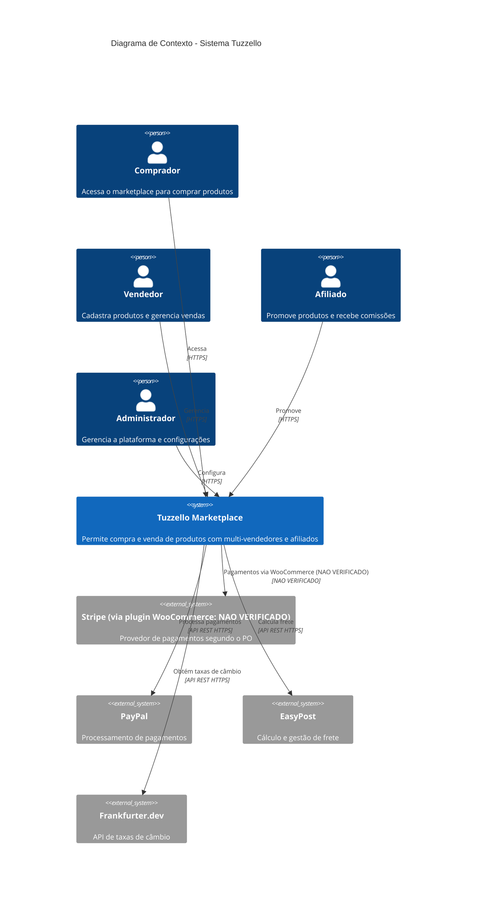
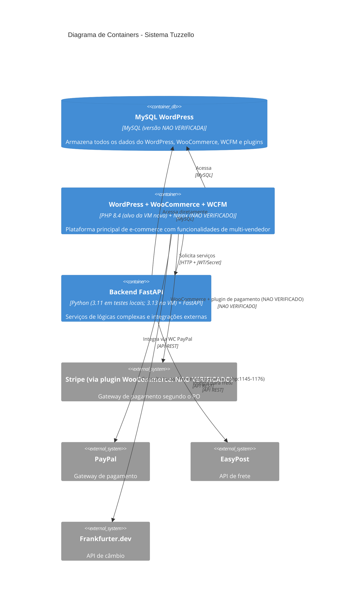
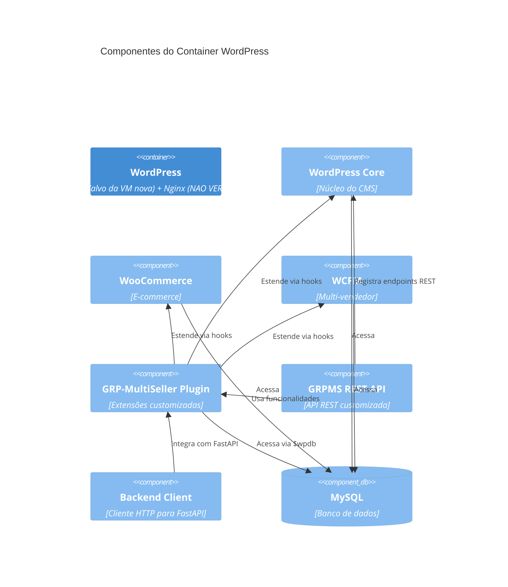
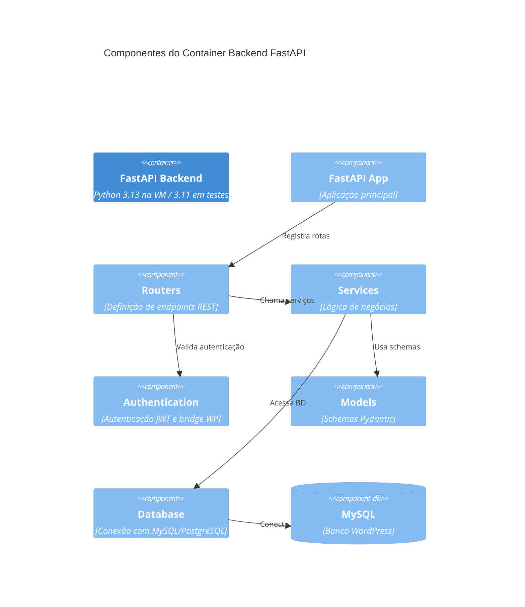

> **STATUS DO DOCUMENTO: PARCIAL** (revisado em 2026-11-03 após validação ARCH-VALIDATE-01 / ARCH-FIX-01). Citações de linha corrigidas contra o HEAD de frontend e backend; o modelo de implantação descrito é o evidenciado pelas docs de implantação (VMs, não contêineres). Itens não confirmáveis no código estão marcados **NAO VERIFICADO**: Nginx, bloqueio público de rotas, status de produção de qualquer componente, Stripe/WooPayments, PayPal, Podman, YITH Affiliates, topologia/IPs, cron (apenas em README-FE.md), instalação do MU-Plugin de mídia. Flags com padrão desligado (`GRPMS_COMMISSION_WATERFALL`, `EASYPOST_BUY_LIVE`, `GRPMS_AUTO_COMPLETE`, `GRPMS_WC_SEND_ENABLED`) estão descritas como tal.
> **ARCH-FIX-04 (2026-11-03) — Stripe e systemd:** (a) Stripe (ARCH-FIX-05): segundo o Product Owner (informação do proprietário, aceita como declarada), o Stripe é o provedor de pagamento da plataforma, usado por meio de um plugin do WooCommerce. O mecanismo dentro do WordPress (qual plugin, versão e configuração) é **NAO VERIFICADO**: não está nestes repositórios. Nenhuma chamada à API Stripe, PaymentIntent, Checkout Session, webhook Stripe ou verificação de assinatura existe em `frontend/` e `backend/fastapi_app` neste HEAD (apenas fixtures em frontend/tests/payout-approval-guard.php:367,395); o checkout guarda o identificador genérico de método de pagamento do WooCommerce e o backend guarda o `transaction_id` recebido do webhook de pedido do WooCommerce. O ponto de integração é o WooCommerce, não o backend. Referências de configuração fora do código (somente nomes de arquivo e linhas; nenhum conteúdo aberto ou registrado): backend/docs/PROCESSO-AUTOMATICO-CONCLUSAO.md:22 (drop-in `stripe.conf`) e :24 (arquivo `backend/infrastructure/secrets/stripe.env`, referência de arquivo apenas, ausente neste workspace); frontend/docs/REGISTRO-ERROS-CORRECOES.md:579. (b) systemd: não consta em CLOUD-DEPLOYMENT.md (frontend e backend); consta em backend/docs/PROCESSO-AUTOMATICO-CONCLUSAO.md:22 (alegação do repositório lab, conflitante com a decisão do PO `grpms-backend`: serviço de usuário `tuzzello-backend`, **NAO VERIFICADO**) e frontend/docs/REGISTRO-ERROS-CORRECOES.md:579; nome de serviço: decisão do PO = `grpms-backend`; a citação `tuzzello-backend` (PROCESSO-AUTOMATICO-CONCLUSAO.md:22) é alegação do repositório conflitante, NAO VERIFICADO; código/implantação: **NAO VERIFICADO**. (c) Citações de arquivo usam caminho completo a partir da raiz do repositório (`frontend/…`, `backend/…`).
> **ARCH-FIX-06 (2026-11-03) — Nome do serviço:** o nome do serviço de backend foi decidido pelo Product Owner como `grpms-backend` (decisão vinculante). O estado da unidade systemd local é **NAO VERIFICADO** (o barramento de usuário estava inacessível). A alegação do repositório lab `backend/docs/PROCESSO-AUTOMATICO-CONCLUSAO.md:22` (serviço de usuário `tuzzello-backend`) conflita com a decisão do PO e permanece citada apenas como alegação: **NAO VERIFICADO**.

> **ARCH-FIX-03 (2026-11-03):** releitura afirmação por afirmação de todo o documento contra `frontend/` e `backend/`. Convenção: **VERIFICADO (arquivo:linha)** = confirmado no código deste HEAD; **NAO VERIFICADO** = não confirmado por código (plugin externo, produção, topologia, documentação apenas). Os diagramas Mermaid são representações do arquiteto; cada elemento é qualificado nas notas "Marcadores" abaixo de cada nível. Como restam afirmações NAO VERIFICADAS (Stripe/PayPal, MySQL em produção, Nginx, portas, VMs), o status permanece **PARCIAL**.

# Diagramas C4 do Sistema Tuzzello

> **Propósito:** Documentar a arquitetura do sistema Tuzzello usando o modelo C4 (Context, Containers, Components, Code). Nota: "container" aqui é o termo do modelo C4 (unidade executável), **não** contêiner Docker/Podman; a implantação descrita nas fontes é por VMs. **Data:** 2026-11-03. Descreve o código no HEAD dos repositórios Frontend e Backend.

---

## 1. Nível 1: Diagrama de Contexto (Context)

O **Sistema Tuzzello** é o marketplace multi-vendedor que permite que vendedores e afiliados ofereçam produtos, e compradores adquiram através de uma plataforma centralizada.



**Marcadores do Nível 1 (ARCH-FIX-03):**
- Relação Tuzzello → EasyPost: VERIFICADO (easypost_service.py:10, :353; origem: backend). Tuzzello → Frankfurter: VERIFICADO (frontend/grpms-main.php:1145-1163; origem: WordPress; também floatrates, :1175).
- Tuzzello → Stripe: provedor segundo o PO, via plugin do WooCommerce (mecanismo NAO VERIFICADO); a relação parte do WooCommerce, não do backend. Tuzzello → PayPal: NAO VERIFICADO. Nenhuma chamada à API Stripe ou PayPal em `frontend/includes`, `frontend/grpms-main.php` ou `backend/fastapi_app`; há apenas detecção de ids de gateway `paypal`/`ppcp` (grpms-checkout.php:1105-1112), e-mail PayPal para repasse (grpms-paypalset.php:20) e leitura de metadados `_wcpay_*` (financial_fee_service.py:8-20).
- Atores: Vendedor `wcfm_vendor` VERIFICADO como string de role usada pelo código (grpms-backend-client.php:95); Afiliado `yith_affiliate` VERIFICADO como string de role (grpms-affiliation.php:17, checkout_service.py:24); Administrador `administrator`/`shop_manager` VERIFICADO (class-grpms-access-capability.php:7-14); Comprador anônimo VERIFICADO (ações `wp_ajax_nopriv_*`, grpms-guest-shipping.php:157-160). As roles pertencem a plugins externos (WCFM, YITH): a existência dos plugins é NAO VERIFICADA.

**Legenda:**
- **Sistema Tuzzello:** Compreende WordPress + WooCommerce + WCFM + Plugin GRP-MultiSeller + Backend FastAPI (composição NAO VERIFICADA para WordPress/WooCommerce/WCFM, plugins externos; VERIFICADA para GRP-MultiSeller e Backend)
- **Atores:** Comprador (anônimo ou registrado), Vendedor (wcfm_vendor), Afiliado (yith_affiliate), Administrador (administrator/shop_manager)
- **Fontes:** frontend/grpms-main.php (definição da role `tuzzello_student`, :13-21; VERIFICADO), README-FE.md (requisitos; documentação)

---

## 2. Nível 2: Diagrama de Containers (unidades C4, não contêineres Podman)

O sistema é dividido em **duas unidades executáveis principais** (VMs `lptaf01web01` e `lptaf01pyt01` segundo a documentação de implantação: frontend docs/CLOUD-DEPLOYMENT.md:3-4, backend docs/CLOUD-DEPLOYMENT.md:3) que se comunicam via HTTP com autenticação baseada em segredo compartilhado. **Modelo de implantação (VMs e serviço `grpms-backend`, backend docs/CLOUD-DEPLOYMENT.md:54, :59): NAO VERIFICADO no código** — fonte: documentação de implantação e de operações; `systemd` NÃO consta em backend/docs/CLOUD-DEPLOYMENT.md nem em frontend/docs/CLOUD-DEPLOYMENT.md; consta em backend/docs/PROCESSO-AUTOMATICO-CONCLUSAO.md:22 (alegação do repositório lab, conflitante com a decisão do PO `grpms-backend`: serviço de usuário `tuzzello-backend`, **NAO VERIFICADO**) e é citado em frontend/docs/REGISTRO-ERROS-CORRECOES.md:579 (EnvironmentFile do host). Discrepância de nome de serviço: `grpms-backend` (CLOUD-DEPLOYMENT.md:54, :59) vs `tuzzello-backend` (PROCESSO-AUTOMATICO-CONCLUSAO.md:22, alegação conflitante, NAO VERIFICADO); decisão do PO: `grpms-backend`. Uso de systemd no código/implantação: NAO VERIFICADO. A comunicação HTTP com segredo compartilhado é VERIFICADA no código (grpms-backend-client.php:27-56, wordpress_bridge.py:10-15).



**Detalhes dos Containers:**

### Container: WordPress
- **Tecnologias:** PHP 8.4 (documentação: frontend docs/CLOUD-DEPLOYMENT.md:82; alvo de validação, NAO VERIFICADO), Nginx (NAO VERIFICADO), WordPress 6.0+ e WooCommerce 7.0+ (README-FE.md:13-14; NAO VERIFICADO no código), WCFM (plugin externo, NAO VERIFICADO)
- **Responsabilidades:**
  - Gerenciamento de usuários e roles (VERIFICADO em parte: roles/registro/ativação em frontend/grpms-main.php:13-21 e grpms-registry.php:140, :212, :487; o arquivo tem 1719 linhas)
  - Catálogo de produtos e carrinho (NAO VERIFICADO: WooCommerce externo; o plugin edita produtos, grpms-products.php:2184)
  - Checkout e processamento de pagamentos (via gateways): checkout customizado VERIFICADO (grpms-checkout.php:848-2108); processamento de pagamento NAO VERIFICADO (gateways externos)
  - Templates e interface do usuário (VERIFICADO: templates/template-add-product.php, frontend/grpms-main.php:1464-1467; includes/*/ shortcodes)
  - REST API interna (VERIFICADO grpms-rest-api.php:908-, namespace `grpms/v1`)
- **Portas:** 443 (HTTPS): NAO VERIFICADO (nenhuma configuração de rede nos repositórios)
- **Arquivos:** /home/gilberto/Projects/Tuzzello-AI-Lab/frontend (caminho de trabalho local deste HEAD; não é caminho de implantação)

### Container: Backend FastAPI
- **Tecnologias:** Python (3.11 em testes locais e 3.13 na VM: backend docs/CLOUD-DEPLOYMENT.md:42, :75; documentação, NAO VERIFICADO no código), FastAPI (VERIFICADO main.py:2), Pydantic (VERIFICADO models.py), JWT RS256 (VERIFICADO jwt_rs256.py:16)
- **Responsabilidades:**
  - Geração de tokens JWT (VERIFICADO token_router.py:18-42)
  - Validação de links de afiliados (VERIFICADO checkout_router.py:27-43; citação anterior :25-44 corrigida)
  - Cálculo de frete via EasyPost (VERIFICADO easypost_router.py:141, easypost_service.py:353)
  - Processamento de pedidos e comissões (VERIFICADO backend/fastapi_app/services/checkout/order_service.py:504, :156)
  - (A consulta de taxas de câmbio é feita pelo WordPress, VERIFICADO frontend/grpms-main.php:1145-1176; busca negativa por Frankfurter/floatrates em `backend/fastapi_app`)
- **Portas:** 8080 interno (exemplo em frontend docs/CLOUD-DEPLOYMENT.md:46; documentação) / 443 público: NAO VERIFICADO no código
- **Arquivos:** /home/gilberto/Projects/Tuzzello-AI-Lab/backend/fastapi_app (caminho de trabalho local deste HEAD)

**Marcadores do Nível 2 (ARCH-FIX-03):** `wordpress → wordpress_db` e `fastapi → wordpress_db` "MySQL": driver `pymysql` e `$wpdb` VERIFICADOS (database.py:20; grpms-rest-api.php:92), MySQL em produção NAO VERIFICADO (database.py:11-18 também suporta PostgreSQL). `wordpress → fastapi` "HTTP + JWT/Secret": VERIFICADO (segredo: grpms-backend-client.php:46-48; JWT: grpms-dashboard.php:152, grpms-gallery.php:177; os JWT dos painéis `seller`/`affiliate` são usados pelo navegador, ver frontend/includes/seller/grpms-seller-dashboard.php:171 e frontend/includes/affiliation/grpms-affiliate-dashboard.php:120). `wordpress → stripe`/`paypal` "Integra via WooPayments/WC PayPal": NAO VERIFICADO (plugins externos; nenhuma chamada nos repositórios). `fastapi → easypost`: VERIFICADO (easypost_service.py:10). `wordpress → frankfurter`: VERIFICADO (frontend/grpms-main.php:1145-1176).

**Comunicação WordPress ↔ FastAPI:**
- Protocolo: HTTP/HTTPS (VERIFICADO: esquemas http e https aceitos, grpms-backend-client.php:12-17)
- Autenticação: Header `X-GRPMS-WP-Secret` (VERIFICADO wordpress_bridge.py:10-15, comparação em :14); rotas de rastreio EasyPost usam identidade de vendedor assinada por HMAC (VERIFICADO wordpress_bridge.py:18-35)
- Rotas permitidas do lado WordPress: `grpms-backend-client.php:33-35` (VERIFICADO; `/api/checkout/save-commissions` consta na lista, mas sem rota no backend e sem chamador: NAO VERIFICADO como rota)
  - `/api/token/from-wp`
  - `/api/easypost/calculate-shipping`
  - `/api/easypost/validate-selection`
  - `/api/checkout/validate-affiliate`
  - `/api/checkout/save-order`
  - `/api/checkout/save-commissions`

---

## 3. Nível 3: Diagrama de Componentes

### 3.1. Container WordPress

O container WordPress contém os seguintes componentes principais:



**Componentes do Plugin GRP-MultiSeller (frontend/grpms-main.php):** carregamento VERIFICADO em frontend/grpms-main.php:1480-1508. Marcadores por linha da tabela (ARCH-FIX-03): Access Control, API Client (1-110), REST API (1-1006), Affiliation, Checkout, Dashboard, Financial (repasses/saques, grpms-payment.php:724), Gallery, KYC (grpms-kyc.php:285), Orders (histórico e aprovação: grpms-orders-history.php:603, grpms-approve_orders.php:9), Platform (frontend/includes/admin/platform/grpms-platform.php:8), Products, Profile, Registry (grpms-registry.php:135), Seller, Training, PWA e General: VERIFICADOS (ver COMPONENT-CATALOG.md seções 1.2–1.19). "Commissions" é a única linha corrigida.

| Componente | Responsabilidade | Arquivo | Linhas |
|------------|------------------|---------|--------|
| **Access Control** | Controle de acesso por role e função | `includes/admin/access/` | - |
| **API Client** | Integração com backend FastAPI | `includes/api/grpms-backend-client.php` | 1-110 |
| **REST API** | Endpoints REST customizados | `includes/api/grpms-rest-api.php` | 1-1006 |
| **Affiliation** | Gerenciamento de afiliados | `includes/affiliation/` | - |
| **Checkout** | Lógica customizada de checkout | `includes/checkout/` | - |
| **Commissions** | **INCORRETO**: arquivo de 11 linhas que apenas imprime `the_content()`; não calcula comissões (VERIFICADO grpms-commissions.php:1-11; citação anterior "1-238" corrigida) | `includes/grpms-commissions.php` | 1-11 |
| **Dashboard** | Painéis de vendedores e afiliados | `includes/dashboard/` | - |
| **Financial** | Gestão financeira | `includes/financial/` | - |
| **Gallery** | Gerenciamento de galeria | `includes/gallery/` | - |
| **KYC** | Verificação de identidade | `includes/admin/kyc/` | - |
| **Orders** | Gestão de pedidos | `includes/admin/orders_history/` | - |
| **Platform** | Configurações da plataforma | `includes/admin/platform/` | - |
| **Products** | Gestão de produtos | `includes/products/` | - |
| **Profile** | Perfil de usuários | `includes/profile/` | - |
| **Registry** | Cadastro de usuários | `includes/registry/` | - |
| **Seller** | Gerenciamento de vendedores | `includes/seller/` | - |
| **Training** | Área de treinamento | `includes/training/` | - |
| **PWA** | Progressive Web App | `includes/pwa/` | - |
| **General** | Funções utilitárias | `includes/general/` | - |

### 3.2. Container Backend FastAPI

O container FastAPI contém os seguintes componentes:



**Routers (fastapi_app/routers/):**

| Router | Responsabilidade | Arquivo | Dependências |
|--------|------------------|---------|--------------|
| Token Router | Geração de tokens JWT | `token_router.py` | WordPress bridge |
| Dashboard Main | Estatísticas do dashboard | `dashboard_main.py` | JWT `get_current_user` (VERIFICADO :11) |
| Seller Dashboard | Dashboard do vendedor | `seller_dashboard_router.py` | JWT (VERIFICADO :14) |
| Affiliate Dashboard | Dashboard do afiliado | `affiliate_dashboard_router.py` | JWT (VERIFICADO :11) |
| Product Gallery | Galeria de produtos | `product_gallery.py` | JWT (VERIFICADO :22) |
| Product Gallery Search | Busca na galeria | `product_gallery_search.py` | JWT (VERIFICADO :19) |
| Checkout Router | Operações de checkout | `checkout/checkout_router.py` | WordPress bridge |
| Shipping Router | Custo de frete do vendedor por país (`GET /get-cost`, VERIFICADO shipping_router.py:15) | `checkout/shipping_router.py` | WordPress bridge (VERIFICADO :10) |
| Order Router | Gestão de pedidos (VERIFICADO: `save-order` e `save-addresses`, backend/fastapi_app/routers/checkout/order_router.py:11, :23) | `backend/fastapi_app/routers/checkout/order_router.py` | WordPress bridge (VERIFICADO :8) |
| EasyPost Router | Integração EasyPost | `checkout/easypost_router.py` | WordPress bridge |
| Mobile Profile | Perfil móvel | `mobile/mobile_profile_router.py` | `require_mobile_user_id` (VERIFICADO :12) |
| Mobile Sales | Histórico de vendas móvel | `mobile/mobile_salehistory_router.py` | `require_mobile_user_id` (VERIFICADO :13) |
| WooCommerce Order | Webhook assinado de pedidos WooCommerce — padrão desligado (`GRPMS_AUTO_COMPLETE`), 404 quando desligado | `webhooks/woocommerce_order.py` | assinatura HMAC (VERIFICADO wc_webhook.py:52) |

**Marcadores dos Routers (ARCH-FIX-03):** todas as linhas da tabela acima são VERIFICADAS (existência, caminho e autenticação) e a coluna Dependências foi corrigida onde era "-"; "Token Router" e "Checkout Router" com "WordPress bridge" já estavam corretos (token_router.py:18; checkout_router.py:16). Registro em main.py:24, :35-48 VERIFICADO.

**Services (fastapi_app/services/):** descrições VERIFICADAS por leitura (ARCH-FIX-03): Refund Store e Auto Complete estão "Unwired" (refund_store.py:1, auto_complete.py:1), WC Client é "LAB-only" (backend/fastapi_app/services/checkout/wc_client.py:1), Shipping Service lê `grpms_user_shipping_zone` (shipping_service.py:5-30), Financial Fee Service lê metadados `_wcpay_*` (financial_fee_service.py:8-20), Alert Mail só no worker e desabilitado salvo configuração (alert_mail.py:1-9). Detalhes em COMPONENT-CATALOG.md 2.4.1.

| Service | Responsabilidade | Arquivo |
|---------|------------------|---------|
| Checkout Service | Lógica de checkout | `checkout/checkout_service.py` |
| EasyPost Service | Integração EasyPost | `checkout/easypost_service.py` |
| Order Service | Processamento de pedidos | `backend/fastapi_app/services/checkout/order_service.py` |
| Shipping Service | Lógica de frete | `checkout/shipping_service.py` |
| Financial Fee Service | Taxas financeiras | `checkout/financial_fee_service.py` |
| Commission Math | Cálculo de comissões | `backend/fastapi_app/services/checkout/commission_math.py` |
| Refund Guard | Proteção de reembolsos | `checkout/refund_guard.py` |
| Refund Store | Reembolsos | `checkout/refund_store.py` |
| Auto Complete | Auto-conclusão de pedidos | `checkout/auto_complete.py` |
| WC Webhook | Verificação HMAC do webhook WC (secret `GRPMS_WC_WEBHOOK_SECRET`), padrão desligado | `checkout/wc_webhook.py` |
| WC Client | Cliente WooCommerce | `backend/fastapi_app/services/checkout/wc_client.py` |
| WC Outbox Worker | Trabalhador de saída | `checkout/wc_outbox_worker.py` |
| Alert Mail | Alertas por email | `checkout/alert_mail.py` |
| Dashboard Statistics | Estatísticas | `dashboard_main_statistics.py` |
| Affiliate Dashboard | Dashboard afiliado | `affiliate_dashboard_service.py` |
| Seller Dashboard | Dashboard vendedor | `seller_dashboard_service.py` |
| Product Gallery | Galeria de produtos | `product_gallery_service.py` |
| Product Gallery Search | Busca na galeria | `product_gallery_search_service.py` |
| Mobile Profile | Perfil móvel | `mobile/mobile_profile_service.py` |
| Mobile Sales | Vendas móvel | `mobile/mobile_saleshistory_service.py` |

---

## 4. Nível 4: Diagrama de Código (Exemplos)

### 4.1. Módulo: Autenticação com WordPress

**Arquivo:** `fastapi_app/auth/wordpress_bridge.py` (trecho VERIFICADO contra o arquivo; os comentários "Linha N" dentro do trecho são aproximados — linhas reais: imports :1-7, `require_wordpress` :10, segredo esperado :11, validação de configuração :12-13, comparação :14-15)

```python
# Linha 1-3: Importações
import os
import secrets
from fastapi import Header, HTTPException

def require_wordpress(supplied: str | None = Header(default=None, alias="X-GRPMS-WP-Secret")):
    # Linha 7: Obtém segredo do ambiente
    expected = os.getenv("GRPMS_WP_SHARED_SECRET", "")
    # Linha 8-9: Validação de configuração
    if len(expected) < 32:
        raise HTTPException(status_code=503, detail="WordPress integration is not configured")
    # Linha 10-11: Comparação segura do segredo
    if not supplied or not secrets.compare_digest(supplied.encode(), expected.encode()):
        raise HTTPException(status_code=401, detail="Unauthorized")
```

**Relacionamentos:**
- Usado por: `token_router.py:18` (dependencies=[Depends(require_wordpress)]) — VERIFICADO; a citação anterior :14 estava incorreta
- Usado por: `checkout_router.py:16` (dependencies=[Depends(require_wordpress)]) — VERIFICADO; a citação anterior :6 estava incorreta
- Também usado por: `backend/fastapi_app/routers/checkout/order_router.py:8`, `shipping_router.py:10`, `easypost_router.py:16` (VERIFICADO)

### 4.2. Módulo: Cliente Backend (WordPress)

**Arquivo:** `includes/api/grpms-backend-client.php` (trecho condensado e VERIFICADO; linhas reais: `grpms_validate_base_url` :5-20, `grpms_api_url` :22, `grpms_backend_http` :27-56, `grpms_backend_request` :58, `grpms_current_user_backend_token` :74; os comentários "Linha N" do trecho são aproximados)

```php
<?php
// Linha 1-5: Cabeçalho de segurança
if (!defined('ABSPATH')) { exit; }

// Linha 14-23: Validação de URL
function grpms_validate_base_url($value): string {
    if (!is_string($value)) {
        return '';
    }
    $v = trim($value);
    if ($v === '' || preg_match('/[\s\x00-\x1F\x7F]/', $v)) {
        return '';
    }
    $parts = wp_parse_url($v);
    if (!is_array($parts) || !in_array($parts['scheme'] ?? '', ['http', 'https'], true)
        || empty($parts['host']) || isset($parts['user']) || isset($parts['pass'])
        || isset($parts['query']) || isset($parts['fragment'])) {
        return '';
    }
    return rtrim($v, '/');
}

// Linha 25-46: Requisição HTTP para backend
function grpms_backend_http(string $path, array $args = []) {
    if (!defined('GRPMS_API_INTERNAL_URL') || !defined('GRPMS_WP_SHARED_SECRET')
        || strlen((string) GRPMS_WP_SHARED_SECRET) < 32) {
        return new WP_Error('grpms_backend_config', 'Backend integration is not configured.');
    }
    // Linha 30-33: Rotas permitidas
    $allowed = ['/api/token/from-wp', '/api/easypost/calculate-shipping',
        '/api/easypost/validate-selection', '/api/checkout/validate-affiliate',
        '/api/checkout/save-order', '/api/checkout/save-commissions'];
    if (!in_array($path, $allowed, true)) {
        return new WP_Error('grpms_backend_route', 'Unsupported backend operation.');
    }
    // Linha 34-46: Construção e execução da requisição
    // ...
}
```

**Relacionamentos:**
- Usado por: `grpms_backend_request()` (VERIFICADO linha 58, citação anterior :49 corrigida)
- Usado por: `grpms_current_user_backend_token()` via `grpms_backend_request` (VERIFICADO linha 74, citação anterior :67 corrigida)

### 4.3. Módulo: Token Router

**Arquivo:** `fastapi_app/routers/token_router.py` (trecho VERIFICADO; linhas reais: imports :1-6, `WPTokenRequest` :10-11, rotas aposentadas :13-16, endpoint :18-42, `create_token` :35)

```python
# Linha 1-5: Importações
from fastapi import APIRouter, Depends, HTTPException
from pydantic import BaseModel, Field
from phpserialize import loads
from fastapi_app.auth.wordpress_bridge import require_wordpress
from fastapi_app.auth.jwt_rs256 import create_token
from fastapi_app.utils.database import get_connection

router = APIRouter()

# Linha 10-12: Schema de requisição
class WPTokenRequest(BaseModel):
    user_id: int = Field(gt=0)

# Linha 25-42: Endpoint de geração de token
@router.post("/api/token/from-wp", dependencies=[Depends(require_wordpress)])
def generate_token_from_wp(body: WPTokenRequest):
    conn = None
    try:
        # Linha 29: Conexão com banco
        conn = get_connection()
        with conn.cursor() as cur:
            # Linha 31-33: Consulta capabilities do usuário
            cur.execute("SELECT m.meta_value FROM wp_usermeta m JOIN wp_users u ON u.ID=m.user_id WHERE m.user_id=%s AND m.meta_key='wp_capabilities'", (body.user_id,))
            row = cur.fetchone()
        # Linha 34-40: Parse e validação
        if not row:
            raise HTTPException(status_code=403, detail="User has no valid roles")
        serialized = row["meta_value"] if isinstance(row, dict) else row[0]
        capabilities = loads(serialized.encode(), decode_strings=True)
        if not isinstance(capabilities, dict):
            raise HTTPException(status_code=403, detail="User has no valid roles")
        roles = [name for name, enabled in capabilities.items() if enabled]
        if not roles:
            raise HTTPException(status_code=403, detail="User has no valid roles")
        # Linha 41: Criação do token JWT
        return {"access_token": create_token({"user_id": body.user_id, "roles": roles, "app": "grpms_plugin"})}
    except HTTPException:
        raise
    except Exception:
        raise HTTPException(status_code=500, detail="Unable to generate token")
    finally:
        if conn is not None:
            conn.close()
```

---

## 5. Mapeamento de Portas e Protocolos

> **Marcadores (ARCH-FIX-03):** esta tabela é inferência do arquiteto. NAO VERIFICADO em todas as linhas de infraestrutura: 443/HTTPS com Nginx, PHP-FPM 9000, Uvicorn 8080 (8080 aparece só como exemplo em frontend docs/CLOUD-DEPLOYMENT.md:46), Nginx do FastAPI 443, MySQL 3306 (padrão no código: `MYSQL_PORT` default 3306, database.py:25, VERIFICADO apenas como valor padrão) e a coluna "Autenticação" de infraestrutura. Autenticação do FastAPI por JWT/segredo: VERIFICADO (wordpress_bridge.py:10, dependencies.py:9). "FastAPI (Uvicorn)": `uvicorn` NAO VERIFICADO nos repositórios lidos. EasyPost: API Key VERIFICADA como variável de ambiente (`EASYPOST_TEST_KEY`/`EASYPOST_LIVE_KEY`, .env.example:11-12); Frankfurter sem credencial VERIFICADO (frontend/grpms-main.php:1145-1176); Stripe e PayPal: NAO VERIFICADO.

| Componente | Porta | Protocolo | Direção | Autenticação |
|------------|-------|-----------|---------|---------------|
| WordPress (Nginx) | 443 | HTTPS | Entrada | Cookies WordPress |
| WordPress (PHP-FPM) | 9000 | FastCGI | Interno | - |
| FastAPI (Uvicorn) | 8080 | HTTP | Interno | - |
| FastAPI (Nginx) | 443 | HTTPS | Entrada | JWT / Secret |
| MySQL | 3306 | MySQL | Interno | Usuário/Senha |
| Stripe (via WooCommerce; NAO VERIFICADO) | 443 | HTTPS | Saída | NAO VERIFICADO |
| PayPal | 443 | HTTPS | Saída | API Key |
| EasyPost | 443 | HTTPS | Saída | API Key |
| Frankfurter.dev | 443 | HTTPS | Saída | - |

---

## 6. Decisões Arquiteturais Visíveis no C4

1. **Separação de serviços:** WordPress e FastAPI são serviços separados (VERIFICADO no código: bases URL distintas `GRPMS_API_INTERNAL_URL`/`GRPMS_API_BASE_URL`, grpms-backend-client.php:23, :29; VMs distintas segundo as docs de implantação, NAO VERIFICADO no código; não contêineres) — a motivação "isolar lógica complexa e melhorar segurança" é NAO VERIFICADA (intenção do arquiteto)
2. **Autenticação via Segredo Compartilhado:** WordPress autentica-se no FastAPI via header `X-GRPMS-WP-Secret` (VERIFICADO wordpress_bridge.py:10-15)
3. **Acesso Direto ao Banco:** FastAPI acessa diretamente o BD WordPress (VERIFICADO database.py:8-30, token_router.py:24); a motivação "evitar latência" é NAO VERIFICADA
4. **Rotas Limitadas:** WordPress apenas pode chamar endpoints específicos no backend pelo cliente `grpms_backend_http` (VERIFICADO grpms-backend-client.php:33-35); os painéis chamam outras rotas diretamente com JWT (frontend/includes/seller/grpms-seller-dashboard.php:171, grpms-dashboard.php:152)
5. **Tokens JWT:** Usuários autenticados no WordPress obtêm tokens JWT para acessar endpoints protegidos do FastAPI (VERIFICADO token_router.py:18-42, grpms-backend-client.php:74-110)

---

## 7. UNVERIFIED Items

- UNVERIFIED: Topologia exata de rede em produção (IPs, sub-redes, load balancers)
- UNVERIFIED: Configuração exata do Nginx para roteamento de requisições
- NAO VERIFICADO: uso de Podman (`backend/podman` é um arquivo vazio de 0 bytes). A implantação descrita nas fontes é por VMs com um serviço `grpms-backend` (backend docs/CLOUD-DEPLOYMENT.md:54, :59); "systemd": `systemd` NÃO consta em backend/docs/CLOUD-DEPLOYMENT.md nem em frontend/docs/CLOUD-DEPLOYMENT.md; consta em backend/docs/PROCESSO-AUTOMATICO-CONCLUSAO.md:22 (alegação do repositório lab, conflitante com a decisão do PO `grpms-backend`: serviço de usuário `tuzzello-backend`, **NAO VERIFICADO**) e é citado em frontend/docs/REGISTRO-ERROS-CORRECOES.md:579 (EnvironmentFile do host). Discrepância de nome de serviço: `grpms-backend` (CLOUD-DEPLOYMENT.md:54, :59) vs `tuzzello-backend` (PROCESSO-AUTOMATICO-CONCLUSAO.md:22, alegação conflitante, NAO VERIFICADO); decisão do PO: `grpms-backend`. Uso de systemd no código/implantação: NAO VERIFICADO
- UNVERIFIED: Status exato de cada endpoint em produção
