# Diagrama entidade-relacionamento
Propósito: representar relações de dados inferíveis de migrations e código; data: 2026-11-03; este documento descreve o HEAD dos repositórios frontend e backend nessa data.

## Diagrama

As ligações tracejadas abaixo são relações lógicas inferidas de campos/joins e IDs, não necessariamente constraints SQL. Os esquemas WP/WooCommerce variam por instalação.

```mermaid
erDiagram
  WC_ORDER ||--o{ GRPMS_MAIN_ORDER : "order_id (lógico)"
  WC_ORDER ||--o| GRPMS_ORDER_PAYMENT_WINDOW : "order_id (lógico)"
  WC_ORDER ||--o{ GRPMS_WC_STATUS_OUTBOX : "order_id (lógico)"
  WC_ORDER ||--o{ GRPMS_PAYOUT_HOLD : "order_id (lógico)"
  WC_ORDER ||--o{ GRPMS_ORDER_DELIVERY : "order_id (PK lógica)"
  WC_ORDER ||--o{ REFUND_OPERATION : "order_id"
  REFUND_OPERATION ||--o{ REFUND_LINE_ALLOCATION : "operation_id"
  REFUND_OPERATION ||--o{ REFUND_FEE_TREATMENT : "operation_id"
  REFUND_OPERATION ||--o{ REFUND_AUDIT : "operation_id (se presente)"
  GRPMS_MAIN_ORDER ||--o{ GRPMS_PAYOUT_ITEM : "main_order_id"
  GRPMS_PAYOUT ||--o{ GRPMS_PAYOUT_ITEM : "payout_id"
  WP_USER ||--o{ GRPMS_TRAINING_ENROLLMENT : "user_id"
  WC_PRODUCT ||--o{ GRPMS_TRAINING_ENROLLMENT : "product_id"
  GRPMS_TRAINING_QUESTION ||--o{ GRPMS_TRAINING_ANSWER : "question_id"
  WP_USER ||--o{ GRPMS_TRAINING_PROGRESS : "user_id"
  WP_USER ||--o{ GRPMS_KYC_SUBMISSION : "user_id"
  WP_POST ||--o{ WP_POSTMETA : "post_id"
  WC_ORDER ||--o{ WP_POSTMETA : "_post_id legado, quando usado"
```

## Evidência e interpretação

| Relação | Evidência no código/schema | Natureza |
|---|---|---|
| Pedido WooCommerce → tabelas GRPMS | Outbox e janelas declaram `order_id`; handler e pagamento recebem IDs de pedido. `backend: sql/auto_complete/002_outbox_and_windows.sql:12-56`; `frontend: includes/training/grpms-training.php:67-85`. | ID lógico; sem FK declarada nessas migrations. |
| Pedido → entrega | DDL usa `order_id` como PK. `backend: sql/t2a/001_grpms_order_delivery.sql:6-`. | PK local; referência ao pedido inferida pelo nome/fluxo. |
| Pedido → operação de reembolso | DDL inclui `order_id` e `wc_refund_id`; índice único composto impede repetição do par. `backend: sql/t2a/002_refund_operation.sql:6-32`. | ID lógico e chave única, não FK declarada. |
| Operação → alocação/taxa/auditoria | `operation_id` nos esquemas seguintes e consultas de código. `backend: sql/t2a/003_refund_line_allocation.sql:6-`; `004_refund_fee_treatment.sql:6-`; `005_refund_audit.sql:6-`. | Relacionamento inferido; constraint de FK UNVERIFIED. |
| Payout → itens → pedido GRPMS | Consultas ligam `grpms_payout_items.payout_id` a `grpms_payouts.id` e `main_order_id` a `grpms_main_orders.ID`. `frontend: includes/financial/grpms-payment.php:1555-1565, 2467-2468`. | JOIN confirmado no código; FK física UNVERIFIED. |
| Treinamento | `question_id` em respostas; inscrições carregam `user_id`, `course_id`, `product_id`, `order_id`, `vendor_id`; progresso tem user/course/module/lesson IDs. `frontend: includes/training/grpms-training.php:45-103`. | Relação lógica; constraints para as entidades referidas não declaradas no DDL mostrado. |
| Metadados WP | A tabela `$wpdb->postmeta` é acessada e a lógica usa `post_id`/`meta_key`; nomes podem refletir prefixo configurado. Exemplo: `frontend: includes/seller/grpms-seller.php:1199-1201`. | Relação WordPress convencional, não descrita por migrations deste escopo. |

## HPOS e tabelas WordPress/WooCommerce

O código usa `wc_get_order()` em fluxos de pedido (por exemplo, `frontend: includes/seller/grpms-seller.php:1213`; `includes/checkout/grpms-checkout.php:1801`), que delega acesso ao data store do WooCommerce. Outro caminho escreve diretamente em `wp_wc_orders` e depois chama `update_status()`/`save()` (`frontend: includes/general/grpms-general.php:1221-1259`). O nome e o caminho sugerem HPOS, mas não há uso confirmado de `wc_orders` e tabelas relacionadas via API direta parametrizada; o nome é hard-coded e não usa `$wpdb->prefix`. As migrations `auto_complete` incluem comentário/grant de leitura em `wp_wc_orders` (`backend: sql/auto_complete/003_grants.reference.sql:61-71`), mas são referência não aplicada.

**UNVERIFIED:** estado HPOS da instalação, sincronização de compatibilidade, tabelas HPOS relacionadas (endereços, operações, itens), prefixo real e integridade entre IDs GRPMS e dados WooCommerce. Nenhuma FK externa é declarada nas migrations exibidas; diagrama não afirma constraints implícitas.
